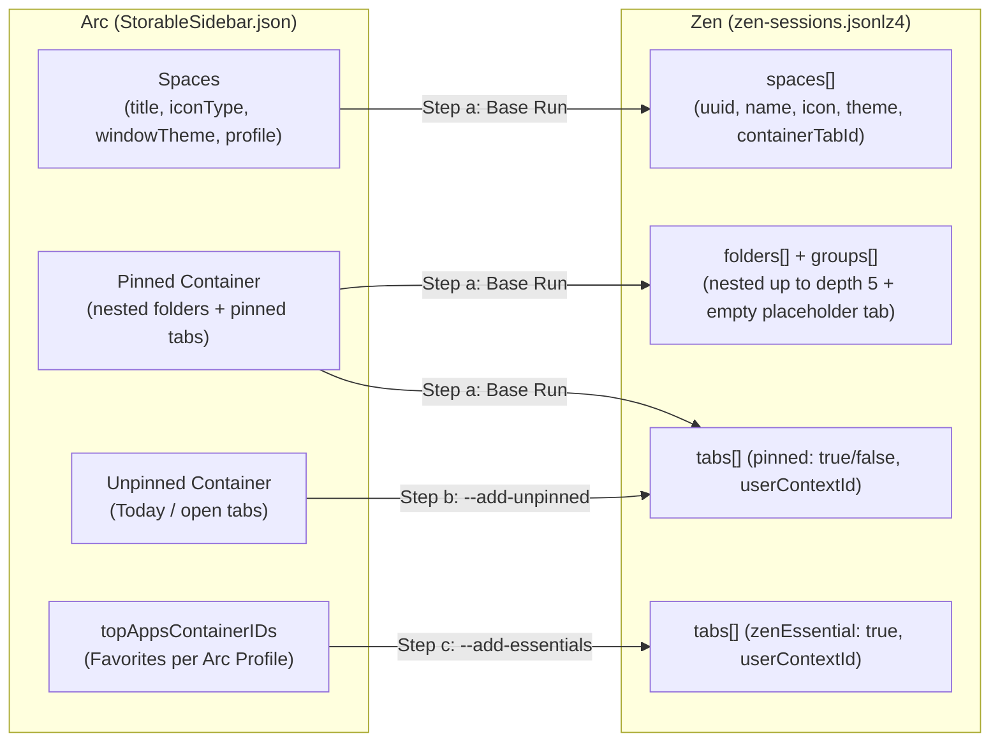

# Migrate Arc to Zen Browser (macOS)

Zero-dependency (except `lz4`) Python toolkit to migrate **Arc Browser** Spaces, Pinned Tabs, Nested Folders (up to Zen's max depth), Unpinned (Today) Tabs, Space Icons/Themes, and Multi-Profile Favorites/Essentials directly into **Zen Browser** (`zen-sessions.jsonlz4`).

> **Safety Guarantee**: Arc's `StorableSidebar.json` is strictly **read-only**. Nothing under `~/Library/Application Support/Arc/` is ever modified, moved, or deleted. Automatic timestamped backups of `zen-sessions.jsonlz4` are created before every write.

---

## Why This Exists: Arc Sunsetting Announcement ([arc.net](https://arc.net/))

The Browser Company announced on **[arc.net](https://arc.net/)** (*"A farewell to Arc"*) that **Arc is shutting down permanently on December 22, 2026** as engineering and security focus shifts exclusively to their new browser, [Dia](https://diabrowser.com).

### TL;DR of the [arc.net](https://arc.net/) Farewell Page (Archived Summary)

- **October 22, 2026**: New Arc account creation disabled. Existing members can still use Arc and export data (`Arc > Settings > Advanced > Export Data`).
- **November 23, 2026**: On iOS and Android (`Arc Search`), *Browse for Me*, AI features, account sign-in, and tab sync are disabled.
- **December 22, 2026 (Hard Cutoff)**:
  - **Arc on macOS and Windows stops working completely** (you will no longer be able to sign in or use the app).
  - All Arc accounts are deactivated and personal account data is deleted within 30 days.
  - `Arc Search` on Android is removed from the Google Play Store and deprecated on installed devices.
- **Why migrate via `StorableSidebar.json` to Zen?**
  1. **Intel Mac (`x86_64`) Support**: Unlike Arc, **Dia requires Apple Silicon (`M1` or later)** and has **no Intel Mac version**. For Intel Mac users (or anyone preferring an open-source Firefox/Gecko engine), Zen Browser (`x86_64` & `arm64`) is the closest Arc alternative.
  2. **Full Structure Preservation**: Arc's built-in export (`Arc > Settings > Advanced > Export Data`) only saves a flat list of links, losing your **Spaces, nested folder hierarchies, theme colors/icons, Pinned vs. Unpinned split, and per-profile Favorites (Essentials)**. Reading `StorableSidebar.json` preserves the entire sidebar structure natively inside Zen Browser.

### Migrating to Dia vs. Zen Browser

| Feature / Requirement | [Dia Browser](https://diabrowser.com) (Official Successor) | [Zen Browser](https://zen-browser.app) (Open-Source Firefox/Gecko) |
|---|---|---|
| **macOS Hardware Support** | **Apple Silicon (`arm64`) only** — *no Intel Mac support* | **Both Intel (`x86_64`) and Apple Silicon (`arm64`)** (plus Linux & Windows) |
| **Engine** | Chromium (same team as Arc) | Firefox / Gecko |
| **Needs a script?** | **No** — built-in 1-click native importer | **Yes** — requires `arc_to_zen.py` |
| **How to import** | Select **Arc** during setup, or **Dia > Import from Another Browser** in the macOS menu bar | Run the 3-step `arc_to_zen.py` workflow below |
| **Spaces & Profiles** | Imported natively as Dia **Profiles** | Imported as Zen **Workspaces** + **Containers** (`containerTabId`) |
| **Pinned Tabs & Folders** | Imported natively (Folders $\rightarrow$ **Tab Groups**) | Imported natively into `zen-sessions.jsonlz4` (`folders[]` + `groups[]`) |
| **Favorites / Essentials** | Imported natively | Imported via `--add-essentials` (`zenEssential: true`) |
| **Passwords, History & Extensions** | Imported automatically in the same step | Import passwords/bookmarks/history via **Zen Settings > Import Browser Data**, then run `arc_to_zen.py` for Spaces/Folders/Tabs |

---

## Repository Contents

| File | Purpose |
|------|---------|
| `arc_to_zen.py` | Direct binary session migrator (`StorableSidebar.json` $\rightarrow$ `zen-sessions.jsonlz4`). Migrates Spaces, themes, icons, nested folders, pinned/unpinned tabs, Essentials, and maps Arc Profiles to Zen Containers. |
| `arc_export.py` | Standalone fallback exporter. Reads `StorableSidebar.json` and writes one standard Netscape Bookmark HTML file (`01_<Space>.html`, etc.) per Arc Space into `./arc-export/`. |
| `LICENSE` | MIT License (permissive use + no-warranty disclaimer). |

---

## Architecture & Data Mapping



### How Arc Concepts Map to Zen

1. **Format (`mozLz4`)**:
   - Zen stores its session in `~/Library/Application Support/zen/Profiles/<profile>/zen-sessions.jsonlz4`.
   - Binary header: 8-byte magic `b"mozLz40\0"` followed by a raw `lz4.block` compressed UTF-8 JSON payload.
2. **Spaces & Themes**:
   - Arc `spaces` become Zen `spaces` (`uuid`, `name`, `theme`, `icon`, `containerTabId`).
   - Arc blended single-color or `primaryColorPalette.midTone` RGB floats (`0.0–1.0`) are converted to `0–255` RGB dots on Zen's workspace gradient theme.
   - Arc emojis (`emoji_v2`) map directly; Arc SF/custom icons map to `chrome://browser/skin/zen-icons/selectable/<name>.svg` (`folder`, `construct`, `planet`).
3. **Nested Folders (`MAX_DEPTH = 5`)**:
   - Each Arc `list` item in a pinned container creates:
     - A Zen `groups[]` entry (`id`, `name`, `color: "zen-workspace-color"`, `collapsed: True`).
     - A hidden `about:blank` placeholder tab (`zenIsEmpty: True`, `groupId: fid`) required by Zen's folder implementation.
     - A Zen `folders[]` entry tracking `parentId`, `prevSiblingInfo`, `emptyTabIds`, and `workspaceId`.
   - Folders deeper than `MAX_DEPTH` (5) or inside unpinned containers are flattened cleanly into their parent.
4. **Multi-Profile Isolation via Zen Containers**:
   - In Arc, multiple profiles share a single sidebar with per-Space cookie/storage isolation and per-profile Favorites bars.
   - In Zen, this is replicated inside a single Zen profile using **Container Workspaces** (`containerTabId` on the workspace + `userContextId` on tabs/essentials):
     - Arc `default` profile $\rightarrow$ `userContextId = 0` (Default / No Container)
     - Non-default Arc profiles (`Profile 1`, `Profile 2`, `Profile 4`, etc.) $\rightarrow$ automatically assigned distinct Zen Container IDs (`userContextId = 1, 2, 3, ...`)
   - Enabling `zen.workspaces.separate-essentials` and `zen.workspaces.container-specific-essentials-enabled` in `prefs.js` scopes Essentials to their matching container workspace automatically.

---

## Step-by-Step Migration Process

### 1. Environment Setup

Create an isolated virtual environment with `lz4==4.4.4` and always invoke Python with `-I` (isolated mode):

```bash
python3 -m venv /tmp/zenv
/tmp/zenv/bin/pip install lz4==4.4.4
```

### 2. Quit Zen Completely

Zen overwrites `zen-sessions.jsonlz4` on shutdown. Always quit Zen and verify the process has exited before writing:

```bash
osascript -e 'quit app "Zen"'
pgrep -fl Zen.app/Contents/MacOS/zen  # Must return empty
```

*(Note: `arc_to_zen.py` also enforces this check and refuses to write if Zen is running.)*

### 3. Run the 3 Migration Passes (Dry-Run First, Then Write)

Run each step **in order, exactly once**:

#### Step (a): Base Run — Spaces + Pinned Tabs + Nested Folders
Replaces existing Zen workspaces/tabs with Arc's Spaces, themes, icons, folders, and pinned tabs.
- **Backup created**: `zen-sessions.pre-arc-<YYYYMMDD-HHMMSS>.jsonlz4`

```bash
# Preview
/tmp/zenv/bin/python -I arc_to_zen.py --dry-run

# Execute
/tmp/zenv/bin/python -I arc_to_zen.py
```

#### Step (b): Unpinned (Open / Today) Tabs — `--add-unpinned`
Appends Arc's unpinned tabs into each matching Zen workspace (flattened, `pinned: False`).
- **Backup created**: `zen-sessions.pre-unpinned-<YYYYMMDD-HHMMSS>.jsonlz4`
- *Warning*: Appends tabs; running more than once will duplicate unpinned tabs.

```bash
# Preview
/tmp/zenv/bin/python -I arc_to_zen.py --add-unpinned --dry-run

# Execute
/tmp/zenv/bin/python -I arc_to_zen.py --add-unpinned
```

#### Step (c): Favorites to Essentials — `--add-essentials`
Reads `topAppsContainerIDs` (paired `[profileObj, containerID, ...]`), maps each profile to its `userContextId`, and prepends Essentials (`zenEssential: True`) deduplicated by `(userContextId, hostname)` and URL.
- **Backup created**: `zen-sessions.pre-essentials-<YYYYMMDD-HHMMSS>.jsonlz4`

```bash
# Preview
/tmp/zenv/bin/python -I arc_to_zen.py --add-essentials --dry-run

# Execute
/tmp/zenv/bin/python -I arc_to_zen.py --add-essentials
```

#### Optional Flag: `--style-only`
Copies only Arc Space icons and theme colors onto existing Zen workspaces matched by name without touching tabs or folders:
```bash
/tmp/zenv/bin/python -I arc_to_zen.py --style-only --dry-run
```

### 4. Enable Container-Specific Essentials in Zen `prefs.js`

While Zen is still closed, ensure these two preferences are present in `~/Library/Application Support/zen/Profiles/<profile>/prefs.js`:

```javascript
user_pref("zen.workspaces.separate-essentials", true);
user_pref("zen.workspaces.container-specific-essentials-enabled", true);
```

### 5. Launch Zen

```bash
open -a Zen
```

---

## Restoring from Backup

Every write creates a timestamped backup in your Zen profile folder (`~/Library/Application Support/zen/Profiles/<profile>/`):

- `zen-sessions.pre-arc-<timestamp>.jsonlz4` *(original state prior to migration)*
- `zen-sessions.pre-unpinned-<timestamp>.jsonlz4` *(state after Step a)*
- `zen-sessions.pre-essentials-<timestamp>.jsonlz4` *(state after Step b)*

To roll back:
1. Quit Zen (`osascript -e 'quit app "Zen"'`).
2. Copy the desired backup over `zen-sessions.jsonlz4`.
3. Reopen Zen (`open -a Zen`).

---

## Using `arc_export.py` (HTML Bookmark Export)

If you also want portable Netscape bookmark HTML files (one file per Arc Space):

```bash
# Export both Pinned and Unpinned tabs to ./arc-export/
python3 arc_export.py

# Export Pinned tabs only
python3 arc_export.py --pinned-only --out ./arc-export
```
